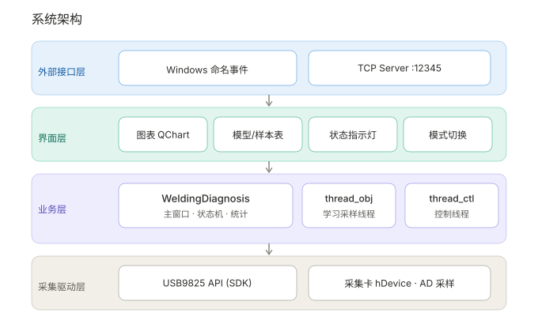
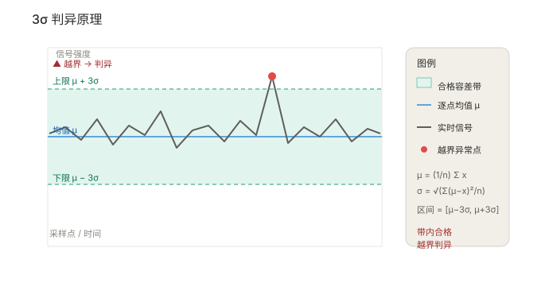

# WeldingDiagnosis

> 基于 Qt 5 与 USB9825 数据采集卡的激光焊接焊缝质量在线检测上位机。

[](https://www.microsoft.com/windows)
[](https://isocpp.org/)
[](https://www.qt.io/)
[](LICENSE)

`WeldingDiagnosis` 是一套面向**激光焊接过程**的光电信号采集与焊缝质量判读软件。它通过 USB9825 高速数据采集卡读取焊接过程中的特征信号，采用「先学习、后检测」的两阶段工作流：在**学习模式**下采集合格样板并统计建立 `均值 ± 3σ` 容差带；在**检测模式**下将实时信号曲线与容差带比对，超限即判定为异常。

项目面向工业现场的上位机使用场景，提供无边框界面、硬件状态指示、外部事件/TCP 触发接口，以及 CSV 数据落盘能力，便于离线复现与二次分析。

---

## 目录

- [核心特性](#核心特性)
- [工作原理](#工作原理)
- [技术栈](#技术栈)
- [快速开始](#快速开始)
- [目录结构](#目录结构)
- [文档索引](#文档索引)
- [适用场景与限制](#适用场景与限制)
- [许可与作者](#许可与作者)

---

## 核心特性

- **双模式工作流**：学习模式建模、检测模式判异，界面一键切换。
- **统计容差建模**：对每个采样点计算样板均值与标准差，生成 `μ ± 3σ` 上下限包络（绿色区域）。
- **实时信号显示**：基于 `Qt Charts` 的样条曲线（`QSplineSeries`）与面积序列（`QAreaSeries`），支持滚轮/框选缩放。
- **硬件状态指示**：运行状态、采集卡连接、控制器连接三组三色状态灯。
- **外部联动接口**：
  - Windows 命名事件 `FELIX_WELD_SIGNAL_001` 同步触发学习流程；
  - TCP Server（`0.0.0.0:12345`）接收 JSON 指令远程触发。
- **数据持久化**：原始信号与模型统计结果分别写入 `Data/test.csv` 与 `Data/test_result.csv`。
- **多模型管理**：以表格形式维护模型名称与样本数量，支持切换当前模型。



---

## 工作原理

软件的核心判据是**统计过程控制（SPC）**思想：假设合格焊缝的信号在时域上服从近似正态分布，则用若干合格样板的逐点均值 `μ` 与标准差 `σ` 构造 `μ ± 3σ` 的合格带。检测时若实时曲线越出该带，则认为过程发生偏移，判为不合格。



详细流程见 [关键流程图](docs/07-architecture.md)。

---

## 技术栈

| 类别 | 选型 |
|------|------|
| 语言 | C++11（MSVC `v142` 工具集） |
| UI 框架 | Qt 5.12（Widgets / Charts / Network / Svg / WebSockets） |
| 开发工具 | Visual Studio 2019 + Qt VS Tools |
| 数据采集 | USB9825 采集卡及厂商 SDK（`USB9825.h/.lib/.dll`） |
| 操作系统 | Windows 7 / 10 x64 |
| 构建产物 | `WeldingDiagnosis.exe` |

> 说明：源码 `.cpp/.h` 采用 **GBK** 编码（内含中文注释与界面字符串），`.ui/.sln/.vcxproj` 为 **UTF-8**。修改源码时请保持编码一致，详见 [注意事项](docs/06-notes.md)。

---

## 快速开始

```bash
git clone https://github.com/felixccty/WeldingDiagnosis.git
cd WeldingDiagnosis
```

1. 安装 Visual Studio 2019（含「使用 C++ 的桌面开发」工作负载）与 Qt 5.12 + Qt VS Tools。
2. 从采集卡供应商处取得 USB9825 SDK，将 `USB9825.h/.lib/.dll` 放入 `src/` 目录。
3. 用 VS 打开 `src/WeldingDiagnosis.sln`，选择 `Debug | x64` 编译。
4. 将可执行文件与 `resources/ico/` 一同部署到同一目录，并把图标目录重命名为 `ico/`。
5. 双击 `WeldingDiagnosis.exe` 启动（需已安装采集卡驱动并插入设备）。

完整步骤见 [运行与部署](docs/03-build-and-run.md) 与 [依赖配置](docs/04-dependencies.md)。

---

## 目录结构

```
WeldingDiagnosis/
├── README.md                     # 项目总览（本文件）
├── LICENSE                       # MIT 许可
├── CHANGELOG.md                  # 版本记录
├── CONTRIBUTING.md               # 贡献指南
├── .gitignore                    # 忽略构建产物与本地配置
├── src/                          # 核心源码（GBK 编码）
│   ├── main.cpp                  # 程序入口
│   ├── WeldingDiagnosis.h        # 主窗口与工作线程类声明
│   ├── WeldingDiagnosis.cpp      # 业务逻辑实现
│   ├── WeldingDiagnosis.ui       # Qt Designer 界面定义
│   ├── WeldingDiagnosis.qrc      # Qt 资源描述
│   ├── WeldingDiagnosis.sln      # VS 解决方案
│   ├── WeldingDiagnosis.vcxproj  # VS 工程配置
│   └── WeldingDiagnosis.vcxproj.filters
├── third_party/
│   └── USB9825.h                 # 采集卡 SDK 接口声明（参考）
├── resources/ico/                # 界面图标资源
├── examples/data/                # 脱敏示例信号与模型数据
├── docs/
│   ├── 01-features.md            # 功能说明
│   ├── 02-structure.md           # 目录结构说明
│   ├── 03-build-and-run.md       # 运行与部署
│   ├── 04-dependencies.md        # 依赖配置
│   ├── 05-usage.md               # 使用示例
│   ├── 06-notes.md               # 注意事项与已知限制
│   ├── 07-architecture.md        # 系统架构与关键流程图
│   ├── build-command.txt         # windeployqt 打包命令
│   └── images/                   # 架构图、流程图与原理图
└── (本地按需放置) USB9825.dll / .lib / ico
```

---

## 文档索引

| 文档 | 内容 |
|------|------|
| [功能说明](docs/01-features.md) | 学习/检测双模式、数据输出、外部接口详解 |
| [目录结构](docs/02-structure.md) | 源文件与资源职责、数据流说明 |
| [运行与部署](docs/03-build-and-run.md) | 编译、目录部署、打包发布 |
| [依赖配置](docs/04-dependencies.md) | 环境版本、SDK 接入、Qt 模块清单 |
| [使用示例](docs/05-usage.md) | 典型操作流程与数据格式示例 |
| [注意事项](docs/06-notes.md) | 编码、硬件、阈值与已知限制 |
| [架构与流程](docs/07-architecture.md) | 模块关系与关键流程图解 |

---

## 适用场景与限制

- 适用于**单通道**光电信号的在线阈值检测，采样长度默认为 `256` 点/帧。
- 当前版本为工程原型，**现场联调仍在进行**；算法与接口以实际发布代码为准。
- 需配合 USB9825 硬件与厂商 SDK 使用；无硬件时可借助示例数据理解数据格式。

---

## 许可与作者

- **许可**：[MIT License](LICENSE)
- **作者 / 项目归属**：Felix
- **仓库**：https://github.com/felixccty/WeldingDiagnosis

本项目以学习和工程交流为目的开源，欢迎 Issue 与 Pull Request。使用本项目前请自行评估其在目标工业场景下的适用性与安全性。
