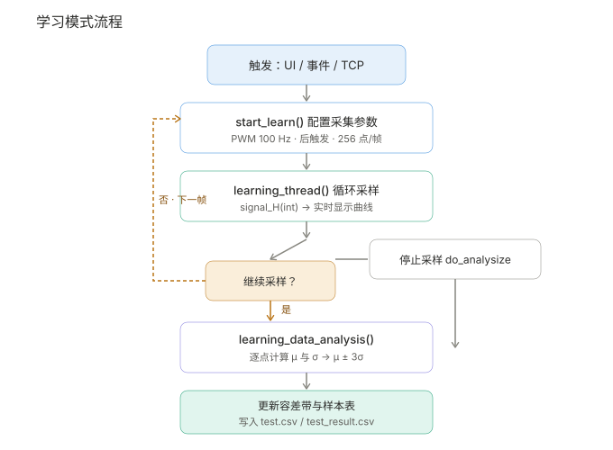
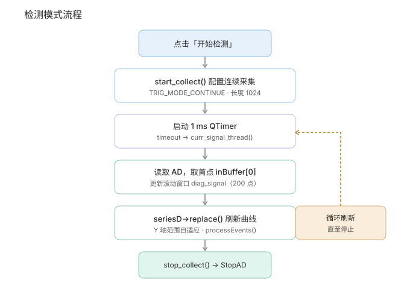

# 功能说明

本文档详细描述 WeldingDiagnosis 的功能模块、业务语义与数据输出格式。实现细节以 `src/WeldingDiagnosis.cpp` 为准。

## 1. 功能总览

| 模块 | 关键函数 | 说明 |
|------|----------|------|
| 双模式切换 | `learnning_mode_click()` / `diagnosis_mode_click()` | 在学习与检测界面间切换，联动主题色与图标 |
| 采集卡连接 | `connect_to_card()` / `initial_collect_card()` | 轮询设备号 0~31，连接首块可用 USB9825 |
| 实时采集 | `start_collect()` / `stop_collect()` / `curr_signal_thread()` | 配置 AD 参数，1 ms 定时器刷新实时曲线 |
| 学习建模 | `start_learn()` / `learning_data_analysis()` | 采样合格样板，逐点计算 `μ±3σ` 容差带 |
| 模型管理 | `add_new_model()` / `click_learn_element()` | 新增模型、设置样本数、切换当前模型 |
| 状态指示 | `check_status()` | 运行/采集卡/控制器三组状态灯 |
| 外部触发 | `send_control_signal()` / `TCP_server()` | 事件与 TCP 两种远程触发方式 |
| 数据输出 | `write_csv()` / `write_learning_data()` / `write_learning_result()` | 原始信号与模型统计落盘 |

## 2. 学习模式

学习模式用于建立判定基准。用户先在界面上「添加模型」，填写模型名称与样本数量，然后采集若干块合格样板。



### 2.1 采集流程

1. `start_learn()` 配置采集参数：
   - 触发模式：`TRIG_MODE_POST`（后触发）；
   - 触发源：`TRIG_SRC_INT_RISING`（内部 PWM 上升沿）；
   - 通过 `USB9825_SetPulGen()` 产生 100 Hz PWM（`40 MHz / 400000`）；
   - 采样长度：`256` 点/帧（`samcnt = 256 × 1 × 1`）。
2. `thread_obj::learning_thread()` 以约 3 ms 周期读取 AD 首通道数据，经信号 `signal_H(int)` 投递到主线程。
3. `show_learning_process()` 将采样点追加到 `seriesH` 与 `curr_vector_H`，并动态调整 Y 轴范围。
4. 外部事件（见 4.1）或 UI 触发一次采样结束，进入统计分析。

### 2.2 统计分析

`learning_data_analysis()` 由 10 ms 定时器轮询，在 `do_analysize` 置位时执行：

- 第 1 个样本：初始化 `avg_H`、`listH_low`、`listH_high` 为样本本身，标准差为 0；
- 后续样本：对每个采样点 `i` 计算

  ```
  μ_i = (1/n) Σ x_i        // 逐点均值
  σ_i = sqrt( (1/n) Σ (μ_i - x_i)² )
  上限_i = μ_i + 3σ_i
  下限_i = μ_i - 3σ_i
  ```

- 结果写入 `seriesH_low` / `seriesH_high`，构成绿色面积容差带；
- 调用 `write_learning_result()` 与 `write_learning_data()` 落盘，并刷新样本表格。

### 2.3 模型与样本表

- `tableWidget_model`：模型名称 + 样本数量；
- `tableWidget_sample`：每完成一次学习记录当前时间（`hh:mm:ss`）；
- 当前选中模型由 `curr_learn_id` 标识，切换时高亮对应行。

## 3. 检测模式

检测模式将实时信号叠加到已建立的容差带上进行判读。



1. `start_collect()` 配置 `TRIG_MODE_CONTINUE`（连续采集），触发源同为内部 PWM 上升沿，`TriggerLength=1024`。
2. `curr_signal_thread()` 每次读取 `samcnt` 点，取首点 `inBuffer[0]` 作为当前值：
   - 未达 `x_max_d=200` 点时追加到 `diag_signal`；
   - 达到后左移窗口，保持定长滚动显示。
3. 曲线通过 `seriesD->replace()` 刷新，Y 轴范围按 `y_min_d`/`y_max_d` 自适应。
4. `stop_collect()` 调用 `USB9825_StopAD()` 停止采集。

> 说明：容差带的可视化由 `initial_signal_chart()` 中 `seriesH` 与 `area_series_H` 实现；`diag_signal_chart` 提供实时滚动视图。开发者可在 `curr_signal_thread()` 中扩展「逐点越界计数 + 判异输出」逻辑，具体判据见 [注意事项](06-notes.md)。

## 4. 外部接口

### 4.1 Windows 命名事件

- 常量事件名：`FELIX_WELD_SIGNAL_001`；
- `thread_ctl::control_thread()` 循环 `OpenEvent` 并以 `WaitForSingleObject(..., INFINITE)` 等待；
- 事件置位后发射 `control_signal(1)`，槽函数 `start_learn_action()` 在「启动 / 停止」两态间切换学习流程；
- `send_control_signal()` 负责 `CreateEvent` 与 `SetEvent`，供本地按钮或联调工具触发。

### 4.2 TCP 接口

`TCP_server()` 在 `0.0.0.0:12345` 监听：

- 接收 JSON，例如 `{"Start":"01"}`；
- `Start == "01"` 或 `"02"` 时调用 `start_learn()`；
- 返回形如 `{"SendTime":...,"Result":"OK","Start":"01",...}` 的 JSON 数组确认。

`TCP_socket()` 提供连接 `127.0.0.1:12345` 的客户端示例，当前构造函数中默认启用服务端、注释掉客户端。

## 5. 数据输出

程序在可执行文件同目录创建 `Data/`：

| 文件 | 内容 | 写入函数 |
|------|------|----------|
| `Data/test.csv` | 每次学习追加一行，逗号分隔的采样点序列 | `write_learning_data()` |
| `Data/test_result.csv` | 5 行：累加和、均值、标准差、下限、上限 | `write_learning_result()` |

CSV 无表头，逐行对应一种统计量；示例见 [使用示例](05-usage.md)。

## 6. 界面与交互

- 无边框窗口，固定 `1160 × 809`，支持鼠标拖动标题区移动、最小化与关闭；
- 顶部双模式按钮（检测/学习）以蓝色/绿色区分当前模式；
- 设置按钮切换基础设置面板；采集卡状态按钮悬停显示状态面板；
- 图表支持 `RectangleRubberBand` 框选缩放与抗锯齿渲染。
