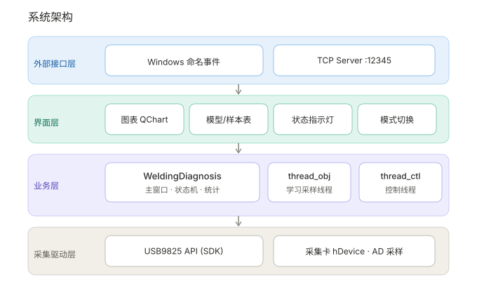
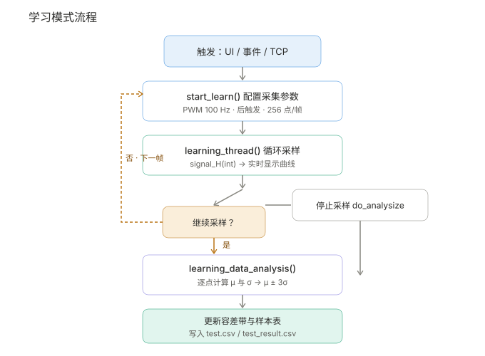
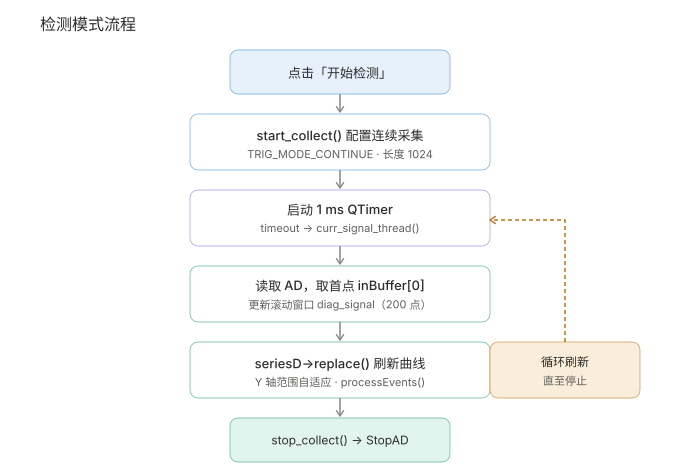
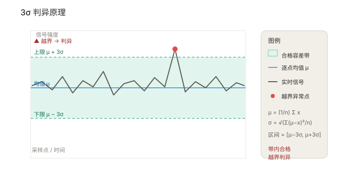

# 系统架构与关键流程

本文档从模块关系与执行流程两个维度描述系统设计，配套示意图位于 `docs/images/`。

## 1. 系统架构

软件分为四层：界面层、业务层、采集驱动层与外部接口层。



| 层次 | 组成 | 职责 |
|------|------|------|
| 界面层 | `WeldingDiagnosis.ui`、`QChartView`、`QTableWidget`、状态灯 | 展示模式切换、实时/统计曲线、模型与样本表 |
| 业务层 | `WeldingDiagnosis` 主窗口、`thread_obj`、`thread_ctl` | 采样调度、统计分析、状态机、数据落盘 |
| 采集驱动层 | `USB9825.h/.lib/.dll`、设备句柄 `hDevice` | 连接设备、配置 AD、读取采样、停止采集 |
| 外部接口层 | Windows 命名事件、TCP/JSON | 接收远程触发，返回应答 |

**数据流**：采集卡 → AD 采样 → 工作线程/定时器 → 主线程统计与图表 → CSV 落盘；外部触发 → 事件/TCP → 学习流程。

## 2. 关键流程一：学习模式

学习模式建立判定基准，是关键业务流程。



流程要点：

1. **入口**：UI 按钮、Windows 事件或 TCP 指令触发 `start_learn_action()`；
2. **初始化**：`start_learn()` 配置 PWM 与 AD 参数（后触发 + 内部上升沿）；
3. **采样**：`thread_obj::learning_thread()` 循环读 AD，信号投递到 `show_learning_process()`；
4. **停止与统计**：采样结束置 `do_analysize=true`，`learning_data_analysis()` 计算 `μ±3σ`；
5. **输出**：刷新容差带、样本表，写入 `test.csv` 与 `test_result.csv`。

## 3. 关键流程二：检测模式



流程要点：

1. `start_collect()` 配置连续采集并启动 1 ms 定时器；
2. `curr_signal_thread()` 每次读取 `samcnt` 点，取首点更新滚动窗口 `diag_signal`；
3. `seriesD->replace()` 刷新实时曲线，Y 轴自适应；
4. `stop_collect()` 调用 `USB9825_StopAD()` 结束。

## 4. 关键流程三：信号判异原理



判据：以合格样板的逐点均值 `μ` 为中心、`3σ` 为半宽构造容差带；实时信号落在带内视为正常，越界则提示异常。数学表达：

```
合格区间_i = [ μ_i - 3σ_i , μ_i + 3σ_i ]
μ_i = (1/n) Σ x_i
σ_i = sqrt( (1/n) Σ (μ_i - x_i)² )
```

> 实现中标准差计算存在已知问题（见 [注意事项](06-notes.md) 第 3 节），二次开发时应先修正并回归验证。

## 5. 时序关系

```text
外部事件/TCP ──> thread_ctl ──control_signal──> start_learn_action
                                                      │
采集卡 ──AD采样──> thread_obj ──signal_H──> show_learning_process
                                                      │
                                          learning_data_analysis (10ms)
                                                      │
                                       write_csv / 更新图表与表格
```

- 学习采样线程与控制线程分别运行在独立 `QThread`，通过信号槽与主线程通信；
- `QTimer` 驱动状态检查（1 s）、实时曲线（1 ms）与统计分析（10 ms）；
- 主线程使用 `qApp->processEvents()` 保持界面响应。

## 6. 扩展建议

- 将 `while(1)` 线程改造为受控循环，增加退出与清理逻辑；
- 在 `curr_signal_thread()` 中加入越界计数与判异结果输出；
- 以配置化方式管理阈值倍数、采样点数、事件名与端口；
- 为 CSV 增加表头与元数据（模型名、时间戳、参数快照），提升可追溯性。
